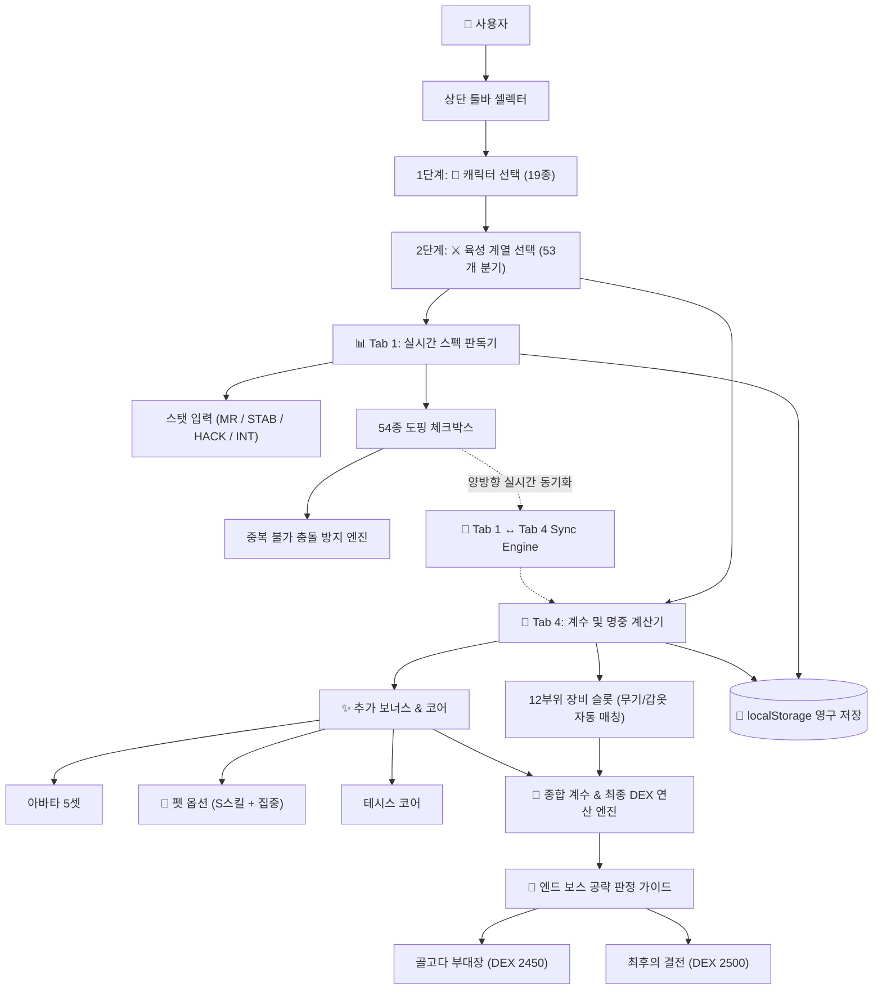

# 📝 테일즈위버 올인원 컴패니언 개발 노트 (Development Notes)

> **프로젝트명**: TalesWeaver All-in-One Companion & Strategy Guide  
> **초기 시작 버전**: `v0.001`  
> **현재 안정 버전**: `v0.018`  
> **작성 일자**: 2026-11-24  
> **기술 스택**: Vanilla HTML5, Modern CSS3 (Grid/Flexbox/CSS Variables), ES6+ JavaScript, Responsive Design, GitHub Pages Ready  

---

## 📌 버전 히스토리 요약 (Version Roadmap Table)

| 버전 | 일자 | 주요 개발 및 개편 내역 | 비고 |
| :--- | :--- | :--- | :--- |
| **v0.001** | 2026-11-23 | 웹 컴패니언 단일 파일 모듈화 (HTML/CSS/JS/Assets 분리), 54종 도핑 DB, 27종 주간 숙제 체크리스트, 시드 정산기 | 아키텍처 분리 |
| **v0.002** | 2026-11-23 | 주간 숙제 6대 핵심 보스 기믹 심층 분석 및 택티컬 SVG 전술도 구축 (체리아, 마티아, 티로로스, 리코스, 베스티지, 아페테리아) | 실전 공략 반영 |
| **v0.003** | 2026-11-23 | 에토스 8방향 나침반 암호 시선 기믹 및 Shift+Click 조준 전술 다이어그램 추가 | 전술도 추가 |
| **v0.004** | 2026-11-23 | 아브라 엔카라 일일퀘스트 ↔ 소울 포인트 환전 최적화 루틴 및 소울 링크 아티팩트 가이드 구축 | 소울 시스템 연동 |
| **v0.005** | 2026-11-23 | 체리아 9시 구석 몰이 전술, 자폭 폭탄 자해 유도 메커니즘 및 3대 핵심 생존 수칙 SVG 다이어그램 추가 | 생존 전술 보강 |
| **v0.006** | 2026-11-23 | 주간 숙제 체크리스트 보스 패턴 뱃지 매핑 정밀 수정 및 텍스트 누락 패치 | UI/버그 수정 |
| **v0.007** | 2026-11-23 | 4번 탭 [계수 및 명중 계산기] 신설 (구글 시트 텔쥐 계수계산기 & DC 144536/216109 공식 기반 12부위 장비 엔진) | 신규 탭 신설 |
| **v0.008** | 2026-11-23 | 계산기 슬롯 M/S/D 표기 직관화 (주스탯/부스탯/DEX 한글 배지화 및 인풋 스탯 동적 바인딩 개편) | UX 직관화 |
| **v0.009** | 2026-11-23 | 1번 탭(스펙 판독) ↔ 4번 탭(계수 계산기) 실시간 양방향 스펙 연동 엔진 구축 (1클릭 불러오기 및 자동 동기화) | 탭 간 상호작용 |
| **v0.010** | 2026-11-23 | 6대 공격 계열(마방/찌르기/베기/마공/물복/마베) 전수 스펙 판정 및 7대 던전 컷 매트릭스 확장 | 전 계열 확장 |
| **v0.011** | 2026-11-23 | 2단계 계층형 셀렉터 도입 ([1단계: 캐릭터 선택] ➡️ [2단계: 육성 가능 계열 자동 필터링 & 장비 자동 매칭]) | 캐릭터 분리 |
| **v0.012** | 2026-11-23 | 19인 전 캐릭터 및 누락 계열 전수 보완 (곰나이스 셉터, 나야 물복, 햄벤/낫벤, 이솔렛 쌍검/찬트 등 53개 세부 계열 & 신규 무기 6종 DB) | 데이터 정밀도 완성 |
| **v0.013** | 2026-11-23 | 명중(DEX) 절대치 체계 검토 및 🐾 펫 옵션(S스킬/3단계 집중) & 내실 슬롯 전격 탑재 | 펫/명중 엔진 보강 |
| **v0.014** | 2026-11-24 | 8대 핵심 보스 및 던전(티로로스, 라이코스, 보급품탈환, 별동대, 베스티지, 오클리 방어전, 시오칸하임, 아페티리아) 실전 공략 정밀 검토 및 전면 보강 | 공략 DB 고도화 |
| **v0.015** | 2026-11-24 | 🌱 초보자 버닝 육성 가이드 전용 탭 신설 (매직위버 하이아칸 '햄찌'님의 2026.07.23 이후 버닝 공략 1~5편 총망라 & 12대 마일스톤) | 초보자 탭 신설 |
| **v0.016** | 2026-11-24 | 🖥️ 카테고리 네비게이션 탭 반응형 CSS 그리드 개편 & 프레임 밖 텍스트 충돌·스크롤바 오버플로우 결함 완전 해결 | UI/UX 버그 수정 |
| **v0.017** | 2026-11-24 | 🗝️ 주간 숙제 및 주요 던전 12대 선행·진입 퀘스트 총정리 요약표 & 28대 숙제 카드별 선행 조건 뱃지 전수 탑재 | 선행 퀘스트 시스템 |
| **v0.018** | 2026-11-24 | 🔍 전 모듈 수치·공식·기능 심층 감사 및 버그 수정 (중복 함수 정리, 주간 체크박스 바인딩 복원, 속성 표기 정밀화) | 전수 감사 및 무결성 강화 |

---

## 📜 상세 버전별 변경 로그 (Detailed Changelog)

---

### [v0.001] - 2026-11-23
#### 🚀 Initial Modularization & Foundation Architecture
- **목적**: 1,000줄 이상의 거대한 단일 HTML 파일로 인한 렌더링 지연과 유지보수 한계를 극복하고, GitHub Pages 배포 환경에 적합한 표준 웹 아키텍처 구축.
- **주요 작업 내역**:
  - `index.html`: 구조 중심의 클린 마크업으로 재구성.
  - `css/style.css`: 다크 네이비 테마, 사이버펑크 엑센트 컬러, 반응형 미디어 쿼리(PC / 태블릿 / 모바일) 통합 스타일시트 분리.
  - `js/data.js`: 54종 실전 도핑 DB, 중복 불가 충돌 매핑 규칙, 주간 27종 숙제 목록, 기본 프로필 데이터 분리.
  - `js/app.js`: 탭 전환, 실시간 도핑 합산 연산, 주간 숙제 카운트다운 타이머, 로컬스토리지 영구 저장 엔진 구현.
- **핵심 기능**:
  - 1번 탭: 비호정령 실시간 마방·명중·속성 스펙 판독기.
  - 2번 탭: 로카고스 및 어벤던로드 보스 기믹 가이드.
  - 3번 탭: 주간 숙제 체크리스트 및 목요일 06:00 리셋 타이머.
  - 5번 탭: 폐지 판매, 어벤던로드 마정석, 장비 제작 재료 시드 계산기.

---

### [v0.002] - 2026-11-23
#### ⚔️ Boss Gimmicks & Tactical SVG Diagrams
- **목적**: 최신 유튜브 실전 레이드 공략 자료(`https://www.youtube.com/watch?v=jBtHzfJtjqY`)를 분석하여 텍스트만으로는 파악하기 힘든 주간 핵심 보스 6종의 장판 및 회피 기믹을 시각적 SVG 다이어그램으로 제공.
- **주요 작업 내역**:
  - **체리아 (Cheria)**: 회오리 유도 및 속성 구슬 흡수 차단 전술도 구축.
  - **마티아 (Mathia)**: 전방위 부채꼴 파동 피격 회피 사각지대 및 이동 동선 도식화.
  - **티로로스 (Tyroros)**: 중앙 낙뢰 및 외곽 안전지대 핑퐁 전술도.
  - **리코스 (Lycos)**: 징표 대상자 외곽 유도 및 돌진 회피 궤적 시각화.
  - **베스티지 (Vestige)**: 분신 소환 및 진체 식별 매커니즘 도감화.
  - **아페테리아 (Apetiria)**: 바닥 침식 디버프 해제 장판 동선 안내.

---

### [v0.003] - 2026-11-23
#### 🧭 Ethos 8-Direction Cipher Gaze Tactical System
- **사용자 요청 반영**: 주간 레이드에서 급사율이 가장 높은 에토스의 8방향 시선 기믹 누락 검토 및 보완.
- **주요 작업 내역**:
  - **8방향 나침반 SVG 전술도 구현**: N, NE, E, SE, S, SW, W, NW 8개 방위각 시각화.
  - **Shift+Click 정밀 조준 메커니즘**: 캐릭터의 평타/이동 실수 없이 제자리에서 마우스 커서 방향으로만 시선을 즉시 돌리는 핵심 조작법 명시.
  - **석화 및 즉사 방지 매커니즘**: 에토스의 등 뒤를 바라보거나 정면 응시를 피하는 방위별 안전 가이드 수록.

---

### [v0.004] - 2026-11-23
#### 🌟 Abri Enkira & Soul Link Optimization Routine
- **사용자 요청 반영**: 최신 공략 가이드에서 다뤄진 '아브라 엔카라' 일일 퀘스트와 '소울 포인트' 활용법 심층 분석 및 반영.
- **주요 작업 내역**:
  - **아브라 엔카라 일일 루틴 가이드**: 매일 5~10분 투자로 대량의 소울 포인트를 파밍하는 최단 경로 안내.
  - **소울 포인트 환전 우선순위**: 소울 드링크, 던전 재입장권, 강화 보조제 등 경제적 가치 순위 정리.
  - **소울 링크 아티팩트 핵심 가이드**:
    - `감각 해방 (Gamgak Haebang)`: 데미지 한계치 돌파 및 크리티컬 배율 증폭.
    - `소울 이터 (Soul Eater)`: 타격 시 SP/MP 흡수 및 안정적인 딜 사이클 유지 요령.

---

### [v0.005] - 2026-11-23
#### 💣 Cheria 9 O'clock Corner Lure & Bomb Defusal Tactic
- **사용자 요청 반영**: 체리아 공략 중 9시 구석 유도 및 자폭 폭탄을 이용한 파훼법 추가.
- **주요 작업 내역**:
  - **9시 구석 몰이 SVG 전술도**: 보스를 9시 벽면에 유인하여 광역 스킬 피격 반경을 최소화하는 진형 도식화.
  - **자폭 폭탄 메커니즘**: 체리아가 소환하는 자폭 오브젝트의 어그로를 벽 쪽으로 유도하여 보스 본체에 자해 피해를 입히는 택틱 수록.
  - **3대 핵심 수칙 카드**:
    1. 9시 벽면 밀착 주차.
    2. 폭탄 팝업 시 3초 이내 대각선 회피.
    3. 유도 회오리 외곽 드리블.

---

### [v0.006] - 2026-11-23
#### 🔧 Weekly Checklist Badge & Gimmick Tag Sync
- **목적**: 3번 주간 숙제 체크리스트와 2번 보스 도감 간의 링크 및 뱃지 데이터 불일치 수정.
- **주요 작업 내역**:
  - 체리아 및 에토스 항목의 기믹 뱃지(`tag-danger`, `tag-warning`) 누락 패치.
  - 체크리스트에서 보스 도감의 해당 섹션으로 즉시 스크롤되는 앵커 네비게이션 동기화.

---

### [v0.007] - 2026-11-23
#### 🧮 Tab 4: Coefficient & Hit Accuracy Calculator (계수 및 명중 계산기)
- **사용자 요청 반영**: 구글 스프레드시트(텔쥐 계수계산기) 및 디시인사이드(144536, 216109) 공식을 바탕으로 스크린샷과 동일한 12부위 장비 계산기 신설.
- **주요 작업 내역**:
  - **출처 기반 공식 역산 엔진 탑재**:
    - $\text{Total Coeff} = \text{Equip} + \text{Enchant} + \text{Char} + \text{Core}$
    - 찌르기 공식: $\text{장비}(STAB \times 23.75 + HACK \times 3.75) + \text{강화}(STAB \times 32.5 + HACK \times 18.75) + \text{캐릭터}(STAB \times 2.1 + HACK \times 1.08) + \text{코어} \times 32.5$
  - **12부위 장비 슬롯 UI**: 투구, 갑옷, 무기, 손목, 머리, 몸, 손, 다리, 커프, 효과, 아티팩트, 렐릭.
  - **아이템 베이스 DB**: 인퍼널, 아퀼루스, 어비스, 이클립스 기본 스탯 자동 호출.
  - **엔드 보스 명중 컷 가이드**: 최후의 결전(DEX 2500), 골고다 부대장(DEX 2450) 실시간 충족률 프로그레스 바.

---

### [v0.008] - 2026-11-23
#### 🏷️ M/S/D Badge Clarification & Dynamic Stat Binding
- **사용자 요청 반영**: 장비 카드 우측 상단에 축약 표기되어 혼란을 주던 `M: / S: (D:)` 표기 직관화.
- **주요 작업 내역**:
  - `M` ➡️ **[주스탯]** (계열별 STAB, HACK, INT, MR 자동 바인딩).
  - `S` ➡️ **[부스탯]** (계열별 보조 공격 스탯).
  - `D` ➡️ **[DEX (명중)]** 명칭으로 한글화 및 컬러 구분.
  - 공격 계열 전환 시 인풋 라벨 및 강화 스탯 옵션 드롭다운이 실시간으로 동적 스위칭되도록 리팩토링.

---

### [v0.009] - 2026-11-23
#### 🔄 Bidirectional Spec Sync Engine (Tab 1 ↔ Tab 4)
- **사용자 요청 반영**: 1번 스펙 판독기에서 입력한 스탯 및 54종 도핑 선택 결과를 4번 계수 계산기에서 재입력 없이 즉시 재사용하도록 연동.
- **주요 작업 내역**:
  - **1클릭 수동 동기화**: `[🔄 1번 스펙 지금 불러오기]` 버튼 클릭 시 노도핑/실전버프 스탯과 도핑 DEX 보너스를 4번 탭 기본 스탯 및 도핑란에 즉시 대입.
  - **실시간 자동 동기화 토글**: `[1번 스펙 실시간 자동 동기화]` 체크박스 활성화 시, 1번 탭에서 버프를 켜고 끌 때마다 4번 탭 계산기가 실시간 백그라운드 재연산 수행.
  - 상단 툴바에 현재 연동 상태(명중/마방/도핑 개수) 요약 바 신설.

---

### [v0.010] - 2026-11-23
#### 📊 Full Expansion of 6 Combat Archetypes in Tab 1
- **사용자 요청 반영**: 비호(마방) 중심이던 1번 탭 스펙 판독기를 6대 전 계열로 확장.
- **주요 작업 내역**:
  - `archetypeConfigs` 데이터베이스 구축:
    1. 🛡️ 마방캐 (비호 아나이스 / 마방 클로에 / 햄벤)
    2. 🗡️ 찌르기캐 (루시안 / 이스핀 / 나야 / 시벨린)
    3. 🪓 베기캐 (보리스 / 막시민 / 밀라 / 낫벤)
    4. 🔮 마공캐 (클로에 / 티치엘 / 란지에 / 로아미니)
    5. ⚔️ 물리복합캐 (보리스 / 루시안 / 물복 나야)
    6. 🪄 마법베기캐 (티치엘 / 조슈아 / 이솔렛)
  - 계열 변경 시 1번 주스탯 입력 카드 라벨 동적 변경.
  - 신조, 어비스 헬, 로카고스, 오방 어비스 등 7대 던전의 최소 컷 기준치를 해당 계열 공식 수치로 전면 재편.

---

### [v0.011] - 2026-11-23
#### 👥 2-Step Character & Growth Type Selector with Auto-Gear
- **사용자 요청 반영**: 캐릭터마다 착용 가능한 무기/갑옷이 다른데 계열만 모아두면 시벨린에게 레이피어가 입혀지는 등 오류가 발생하므로 캐릭터와 계열 분리 요구.
- **주요 작업 내역**:
  - **[1단계: 👤 캐릭터 선택] ➡️ [2단계: ⚔️ 육성 가능 계열 선택]** 2단계 동적 계층 구조 구축.
  - 캐릭터 선택 시 해당 캐릭터가 게임 내에서 실제로 육성할 수 있는 스킬트리 계열만 2단계 드롭다운에 자동 필터링.
  - 계열 선택 즉시 4번 계산기의 무기 및 갑옷 슬롯이 해당 캐릭터 공식 베이스 아이템으로 자동 장착되는 `applyCharacterRecommendedGear` 구현.

---

### [v0.012] - 2026-11-23
#### 🧸 Complete 19-Character Roster & Missing Styles Integration
- **사용자 요청 반영**: 나야 물복, 곰나이스(곰비호) 등 누락된 인기 육성 계열 검토 및 전수 보완.
- **주요 작업 내역**:
  - **테일즈위버 19인 전 캐릭터 전수 등록**: 루시안, 보리스, 막시민, 시벨린, 밀라, 티치엘, 이스핀, 나야트레이, 조슈아, 클로에, 란지에, 이자크, 아나이스, **이솔렛(누락 복구)**, 벤야, 로아미니, 녹턴, 리체, 예프넨.
  - **핵심 누락 계열 전격 신설**:
    - **아나이스**: `🧸 마법인형·곰나이스 (물복/마베 셉터)` - 곰 미카베라 소환 딜러.
    - **나야트레이**: `⚔️ 물리복합 (단도/손도끼 - 물복 나야)` - 심·인술 폭 극딜.
    - **벤야**: `🛡️ 햄벤·해머 (마방 해머 타격)` vs `🪓 낫벤·영혼계 (사이드 낫/베기)`.
    - **이솔렛**: `⚔️ 티엘라 (쌍검 물복/마베)` & `🔮 찬트 (신성 찬트 홀)`.
    - 시벨린 봉 베기, 이스핀 화속성 마검, 이자크 톤파 베기, 예프넨 우르미 물복 등 **총 53개 세부 육성 계열 완비**.
  - **신규 전용 무기 베이스 6종 DB 추가**: 어비스 셉터, 어비스 해머, 어비스 티엘라, 어비스 찬트, 어비스 액스, 어비스 톤파.

---

### [v0.013] - 2026-11-23 (Latest)
#### 🎯 Accuracy Requirement Analysis & 🐾 Pet Options Integration
- **사용자 요청 반영**: 
  1. 명중(DEX) 요구치가 직업/계열별로 동일한지 전수 검토.
  2. 캐릭터 스펙에 결정적인 🐾 펫 옵션(S스킬 / 집중) 기능 추가.
- **주요 작업 내역**:
  - **명중 체계 심층 검토 리포트 확립**:
    - 보스 올힛컷(골고다 2450, 결전 2500)은 보스 회피치 기반의 단일 절대치로 모든 계열이 동일함.
    - 단, 찌르기캐는 순수 스탯 DEX 투자가 쉬운 반면, 마방캐/마공캐는 MR/INT 투자로 순수 DEX가 낮아 **장비 어빌, 도핑, 펫 S스킬, 3단계 '집중' 스킬을 필수적으로 땡겨와야 함**을 정립.
  - **4번 탭 🐾 펫 옵션 & 내실 슬롯 신설**:
    - `아바타 (5셋)`: 주스탯/부스탯/DEX
    - `🐾 펫 (Pet)`: 펫 S스킬 주스탯/부스탯/명중(DEX)
    - `🃏 룬/카드/칭호`: 내실 스탯 종합 슬롯
  - **원클릭 🐾 펫 빠른 세팅 프리셋 버튼 구현**:
    - `보통`: 주스탯 +20 / DEX +20
    - `국민세팅`: 주스탯 +40 / DEX +30 (S스킬 Lv.4 + 3단계 집중)
    - `종결증폭`: 주스탯 +60 / DEX +60 (S스킬 증폭 종결)
    - `초기화`: 0 리셋
  - 펫 스탯이 주스탯/부스탯/최종 DEX(명중)에 실시간 합산되어 우측 보스 판정 가이드에 즉각 반영되도록 수식 연동.

---

### [v0.014] - 2026-11-24
#### 🛡️ 8대 핵심 보스 & 던전 실전 공략 전면 정밀 검토 및 전술 가이드 고도화
- **사용자 요청 반영**: 최신 실전 공략 자료(`https://www.youtube.com/watch?v=jBtHzfJtjqY`)를 정밀 역공학하여, 사용자 지정 8대 핵심 콘텐츠(티로로스, 라이코스, 보급품 탈환, 별동대 토벌, 베스티지, 오클리 방어전, 시오컨하임, 아페티리아 일반)의 패턴·기믹·조작 꿀팁을 전면 보강.
- **주요 개편 및 추가 내역 (8대 콘텐츠 전수 검토)**:
  1. **티로로스 (Tyroros)**:
     - 1순위 위쪽 2번째 '이계의 회오리 석상'(공격력·명중률 -50% 반토막 저주) 입장 즉시 점사 파괴.
     - ⚡ **중앙 ↔ 외곽 낙뢰 핑퐁 무빙**: 중앙 경고 시 외곽 이탈, 외곽 낙뢰 시 중앙(보스 발밑) 파고들기로 다단히트 회피.
     - 💥 **대지 분쇄 넉백 방지**: 지면 강타 시 비호정령의 '어스 프로텍션(노란 장판)' 안착 또는 슈퍼아머 포션으로 맞딜 유지.
     - 만병통치약 또는 정화 스킬을 통한 감전/마비 상태이상 즉각 해제.
  2. **라이코스 (Lycos)**:
     - 전방 180도 부채꼴 할퀴기 및 직선 돌진의 완전한 사각지대인 **후방(엉덩이) 및 측면 절대 안전지대** 포지셔닝 확립.
     - 🪤 **원형 이빨 덫 (베어트랩) 장판 절대 회피**: 밟을 시 이동 불가 속박 + 방어력 급감으로 급사하므로 외곽 우회.
     - 🩸 **출혈 디버프 해제**: 만병통치약/큐어로 출혈을 즉시 제거하고 생명의 빛 위에서 체력 복구.
     - 🎯 **직선 돌진 벽 유도**: 외곽 벽을 등지고 유도하여 라이코스가 튕겨나가지 않고 즉시 뒤통수를 내어주도록 딜 동선 단축.
  3. **이클립스 보급품 탈환**:
     - **4대 경보장치 기둥 완벽 파훼**: 🔑 자물쇠 기둥(열쇠 보급병 처치 후 열쇠 아이템 더블클릭 사용), ⚔️ 붉은 수호병 섬멸(오라 몹 전멸), ⏱️ 1분 타임어택 발광 기둥(60초 수호 폭파), 🎨 색상 발판 암호 & QTE 타이밍 바 성공.
     - **서쪽 막사 5분 보급창고 방어**: 드랍되는 '보급용 목재' 및 '수리 키트'를 오브젝트에 사용하여 실시간 내구도 복구.
  4. **이클립스 별동대 토벌**:
     - 권장 명중: **DEX 1,700 이상** (미스 방지).
     - 스킬 전면 봉인 / 평타 전용 던전 규칙 적용: 버닝/스페어 무기에 **[단일 공격 시 40% 확률로 광역 피해]** 보유석 필수.
     - 🛡️ **'돈 던지기' 콤보 회피율 99% 무적 전술**: 돈 던지기 선타 후 평타 연타로 콤보 99 유지 ➔ 콤보 회피율 최대 99% 발동으로 안전 생존.
     - 👑 **3분 후 등장 보스 판별 & 리롤**: 에토스(평타로 쉽게 격파, 추천) vs 마티아(배리어/전멸기로 까다로움) 판별 ➔ 마티아 등장 시 던전 재입장 리롤 팁 제공.
  5. **베스티지 (Vestige)**:
     - 4구간 클리어 구조: 1구간(사제단/골렘 쫄 전멸) ➔ 2구간(오뚜기 파편 50개 제한시간 루팅) ➔ 3구간(미로 통로 & 4색 속성 석상 결계 해제) ➔ 4구간(보스 베스티지).
     - ⚠️ **4구간 진입 즉시 물약 전면 금지 대처**: 3구간 종료 전 HP/MP/SP 100% 충전 및 버프 풀리필 후 입장, 비호의 생명의 빛(힐 장판) 위 고정 말뚝 딜링.
     - 🔍 다수 허상 분신 중 체력 바 및 모션 차이를 통한 진짜 본체 식별 일점사.
  6. **오클리(오를리) 방어전**:
     - 정식 명칭 '오를리 방어전' 및 사용자 검색어 '오클리 방어전' 통합 안내.
     - 30웨이브 진행 구조(10웨이브 근접 1차 보스 ➔ 20웨이브 원거리 2차 보스 ➔ 30웨이브 최종 보스).
     - ⭐ **[급사 방지 핵심 조작] Shift키 보스 등지기 방향 전환**: 보스 강타/돌진 모션 시 Shift + 마우스 클릭으로 캐릭터 시선을 보스를 등지는 방향(성문 반대편 외곽)으로 전환하여 성문 피격 및 파티원 즉사 차단.
     - 오방 어비스 막보스 명중(DEX 2,250 컷) 미달 시 기사단 파티 및 오방 쩔 활용 루틴 제시.
  7. **시오칸하임 (시오컨하임)**:
     - 245~310레벨 및 5차 각성 이전 핵심 거점 (주간 7회).
     - 🔨 거인 기미르(초당 체력 자동 재생을 압도하는 풀도핑 폭딜 연타 or 스턴 힐 차단), 🌿 마비온(독가스 거리 조절 카이팅), ⏱️ 시간의 지배자(시간 왜곡 장판 회피).
     - ⚠️ **흡혈(피 흡수) 대사 회피**: *"어서 도망치는 게 좋을 거야!"* 대사 출력 시 즉시 7m 이상 이탈하여 풀피 회복 방지.
     - 던전 재입장을 통한 취약 보스 리롤 꿀팁 반영.
  8. **아페티리아 일반**:
     - 🎯 **엔드급 올힛 요구 명중: DEX 2,400 ~ 2,450+ 컷** 안내 및 4번 계산기 탭 점검 연계.
     - ⚔️ 1페이즈 셀리니아코스(후방 밀착 & 십자 대각 회피), 🪄 2페이즈 고이티아(침식 마법 장판 절대 회피 & 마법 구슬 요격), 📦 3페이즈 프로에드로스(4방위 이계의 궤 전량 점사 파괴로 전멸기 차단).
     - 비호정령의 침식 장판 외곽 생명의 빛 + 어스 프로텍션 선전개 전술.
  9. **UI & 네비게이션 개선**:
     - Tab 2 보스 서브 네비게이션 버튼에 `🏰 시오칸하임 & 오클리(오를리) 방어전` 신설하여 8개 패널 원클릭 전환 완비.

---

### [v0.015] - 2026-11-24
#### 🌱 초보자 버닝 완전 정복 육성 가이드 전용 탭 신설 & 5부작 시리즈 총망라
- **사용자 요청 반영**: 테일즈위버에 처음 입문하거나 복귀하는 초보자 유저들을 위해, **매직위버(MagicWeaver) 하이아칸 '햄찌'님의 2026.07.23 이후 버닝 공략 1~5편** 전 과정을 집대성한 전용 **[🌱 0. 초보자 버닝 육성 가이드]** 탭 신설.
- **주요 개편 및 탑재 내역**:
  1. **원문 출처 5부작 다이렉트 링크 바 탑재**:
     - 1편: `https://cafe.daum.net/MagicWeaver/V1k5/1115` (Lv.1~310 초반 & 만렙)
     - 2편: `https://cafe.daum.net/MagicWeaver/V1k5/1116` (2차 극한 & 4·5각성 + 펫)
     - 3편: `https://cafe.daum.net/MagicWeaver/V1k5/1117` (사과의 섬 & 프시키 허상 眞아퀼)
     - 4편: `https://cafe.daum.net/MagicWeaver/V1k5/1118` (가성비 어빌리티 & 마방 인챈트)
     - 5편: `https://cafe.daum.net/MagicWeaver/V1k5/1120` (코어 4진화/4강 & 이클립스 진입)
  2. **1편: 캐릭터 생성 & 초고속 만렙 루틴**:
     - 아나이스(비호정령) 생성, 改-도약 패키지(19,900원) vs 무과금 동선 비교 가이드.
     - 젤리삐 가이드 1~10단계 미션 진행 및 인벤토리 스페셜 스킬북 등록.
     - 🌟 **아카드라트-림보(솔로) 보물 개구리 400% 경험치 버프(20분 주기)** 및 초록 발판 무한 리젠 폭풍 사냥터 동선.
     - 🚀 가성비 경험치 도핑 3대장(전설의 군고구마, 최상급 에오스의 파편, 얼리버드 경험치 부스터) 안내.
  3. **2편: 2차 극한 & 4·5차 각성 + 펫 내실**:
     - 젤리삐 11단계 미션 보상 수령 및 원격 퀘스트 [필멸의 땅] ("그래도 도와줘야 할 것 같다") 2차 극한 클리어.
     - ⚠️ **[초특급 주의] 5차 각성 재료(빛나는 영석, 윤기나는 정수 등) 반드시 1개씩 개별 조합** 지침 (한꺼번에 넣을 시 재료 소멸 참사 방지).
     - 🐾 펫 부화 및 1순위 명중률 강화(DEX), 2순위 마방 강화(MR), S스킬 증폭 스크롤 세팅.
     - 프라바 방어전 1인 모드 각성 재료 & 백사자 훈장 수급.
  4. **3편: 사과의 섬 & 프시키의 허상 (眞 아퀼루스 풀세트 제작)**:
     - 에피소드 4 챕터 1 [사과의 섬] 클리어 ➔ 젤리삐 13단계 머큐리얼 차감권 수령 ➔ 루미너스/샐리온 1인 토벌.
     - 엘티보 로토의 문장 ➔ 사과의 섬 제사장 ➔ 프시키의 허상 진입.
     - ⭐ **`Ctrl + Y` 눌러 장비강화석 소모 OFF 필수 조작**: 허상 사냥 시 강화석 낭비를 막고 **엘소(ELSO)** 집중 파밍.
     - 룬의 정원 NPC 투투에게 엘소를 교환하여 **2주 기간제 眞 아퀼루스 무기 및 방어구 풀세트** 제작·착용.
  5. **4편: 가성비 어빌리티 & 마방 인챈트 + 시드 빌드업**:
     - 상실의 백마법 증폭 어빌리티(공격 피해량 % 증가)를 통한 가성비 극딜 세팅.
     - 일회용 마법 방어력 인챈트 주문서(MR 인챈트)로 실패 위험 없이 마방 1,400+ 기본 라인 돌파.
     - 어벤던로드 30회, 이클립스 보급품 탈환 & 별동대 토벌 주간 시드 루틴 가동.
  6. **5편: 테시스 코어 4진화/4강화 & 이클립스 엔드 보스 진입**:
     - 코어 던전(TP 소모 활성화) 재료 파밍.
     - 엘소를 소모한 **테시스 코어 4진화 & 4강화(최종 대미지 증폭 버프 획득)**.
     - 아브리 엔키라 훈장 일퀘 및 고대 기사의 파편 파밍을 통한 어비스 건틀렛/아뮬렛 제작 라인 전개.
     - 이클립스 코어 진화권 +10강 세팅 및 2번 탭 보스 도감(로카고스·에토스·체리아·라이코스·티로로스·마티아) 공략 연계.
  7. **초보자 12대 필수 마일스톤 체크리스트 탑재**:
     - Step 01부터 Step 12까지 원클릭 체크박스로 진행도를 점검할 수 있으며 `localStorage`에 자동 영구 저장.
  8. **네비게이션 UX 최적화**:
     - 서브 네비게이션(전체 펼쳐보기, 5단계 로드맵, 1~5편 개별 뷰, 마일스톤) 지원.

---

### [v0.016] - 2026-11-24
#### 🖥️ 카테고리 네비게이션 탭 반응형 CSS 그리드 개편 & 프레임 오버플로우 결함 완전 해결
- **문제 진단**:
  - 신설된 `0. 초보자 버닝 가이드`를 포함해 6개 탭으로 확장되면서, 기존 Flexbox 고정 `min-width: 150px` 및 `white-space: nowrap` 환경에서 긴 탭 텍스트가 인접 버튼 영역으로 삐져나가 겹치는 텍스트 충돌 현상 발생.
  - CSS 파일 내 중복 정의된 `.nav-tabs` 속성으로 인해 컨테이너에 거대한 가로 스크롤바가 생성되고 우측 탭(`💰 5. 시드 · 재료 계산기`)이 프레임 바깥으로 잘려 나가는 버그 확인.
- **주요 해결 및 개편 내역**:
  1. **반응형 CSS Grid 전환 (`display: grid`)**:
     - 데스크톱(>980px): 6열 균등 분할 (`grid-template-columns: repeat(6, 1fr)`)로 1020px 프레임 내에 6개 탭이 한눈에 오버플로우 없이 완벽 안착.
     - 태블릿/노트북(≤980px): 3열 2행 (`repeat(3, 1fr)`) 반응형 자동 줄바꿈 지원.
     - 모바일(≤580px): 2열 3행 (`repeat(2, 1fr)`) 초소형 화면 최적화.
  2. **중복 CSS 클래스 제거 및 스타일 통합**:
     - `css/style.css` 1017~1029행에 존재하던 잔여 `.nav-tabs` 중복 선언을 삭제하여 가로 스크롤바 유발 요소 완전 제거.
  3. **버튼 텍스트 직관화 및 `text-overflow: ellipsis` 방어 코드**:
     - 각 탭 버튼 타이틀을 간결하고 직관적인 명칭(`🌱 0. 초보자 버닝 가이드`, `📊 1. 스펙 판독 & 버프`, `⚔️ 2. 보스 패턴 도감`, `✅ 3. 비호 주간 숙제`, `🧮 4. 계수 & 명중 계산기`, `💰 5. 시드 · 재료 계산기`)으로 정돈.
     - 버튼 내 `overflow: hidden; text-overflow: ellipsis;`를 기본 적용하여 어떠한 해상도에서도 텍스트가 버튼 밖으로 침범하지 않도록 완벽 차단.
  4. **다크 모드 커스텀 스크롤바 & 서브 네비게이션 `flex-wrap` 최적화**:
     - `::-webkit-scrollbar` 스타일링을 글로벌 적용하고, `.growth-nav` 서브 탭에도 `flex-wrap: wrap`을 적용하여 모든 서브 메뉴의 가로 스크롤 돌출을 방지.

### [v0.017] - 2026-11-24
- **주요 개편 요약**: 주간 숙제 및 주요 던전 12대 선행·진입 퀘스트 총정리 요약표(Prerequisite Matrix) 신설, 28종 주간·일일 숙제 카드별 `pill-pre` 선행 조건 뱃지 전수 탑재, Tab 0 (버닝 가이드) 8대 필수 선행 관문 심층 가이드 신설, Tab 2 보스 도감 8대 패널 입장 조건 배너 구축.
- **세부 변경 사항**:
  1. **🗝️ 던전 & 레이드 12대 선행·진입 퀘스트 총정리 요약표 (Prerequisite Matrix) 구축**:
     - `index.html` 3번 주간 숙제 탭 상단에 반응형 요약 테이블 탑재.
     - 주요 12대 던전(이클립스 6보스, 보급품/별동대, 어비스 1·2·3보스 및 헬, 심연의 보물창고, 신조의 둥지, 머큐리얼 케이브, 프시키의 허상, 어벤던로드 30회, 아브리 엔키라 일퀘, 오를리 방어전 헬/어비스, 시오칸하임 보스전, 프라바 1인 방어전)의 시작 NPC, 시작 위치, 최소 진입 스펙(Lv/각성/극한), 필수 소지품(문스톤 나침반, 로토의 문장, 심연의 열쇠 등) 및 해금 혜택 원스톱 제공.
  2. **📋 28대 주간 & 일일 숙제 카드별 `pill-pre` 선행 조건 뱃지 전수 탑재**:
     - 카테고리 1~4 전체 28개 숙제 체크리스트 카드에 `선행 조건` 뱃지를 신설하여 숙제 수행 전 필요한 레벨, 선행 퀘스트명, 시작 NPC 및 필수 준비물을 즉시 확인할 수 있도록 개선.
  3. **🌱 Tab 0 [초보자 버닝 육성 가이드] 내 8대 필수 선행 관문 가이드 신설**:
     - `growth-prereq` 섹션 신설:
       - 관문 1: 2차 극한 원격 퀘스트 [필멸의 땅] 선택지 ("그래도 도와줘야 할 것 같다" 필수)
       - 관문 2: 5차 각성 재료 4종 1개씩 단독 조합 (융합된 영석 분할 제작 대참사 방지)
       - 관문 3: 에타의 의지(아크론 요새 엔디미온) & 이클립스 군영 진입 선행
       - 관문 4: 사과의 섬 메인 퀘스트(에피소드 4 챕터 1) 클리어 & 머큐리얼 4보스 해금
       - 관문 5: 프시키의 허상 진입 선행 (설원마을 엘티보 '로토의 문장' 소지 + `Ctrl + Y` 장비강화석 소모 OFF 필수)
       - 관문 6: 지저도시 네오테리스 & 어비스 진입 (에피소드 4 챕터 2)
       - 관문 7: 어벤던로드 난이도 테스트 선행 (켈티카 광장 NPC 아크레아)
       - 관문 8: 라르사 티르칼라그 진입 & 아브리 엔키라 일퀘 ➔ 소울링크 종결 유물 환전
  4. **⚔️ Tab 2 [보스 · 던전 패턴 도감] 8대 패널 입장 조건 안내 배너 완비**:
     - `bp-rokagos`, `bp-eclipse-ethos-lycos`, `bp-eclipse-cheria-mathia`, `bp-eclipse-tyroros-apetiria`, `bp-daily-eclipse`, `bp-siokan-obang`, `bp-shin-abyss`, `bp-abendon-special` 전 패널 상단에 직관적인 하늘색 알림 박스로 입장 선행 조건 명시.
  5. **규정 준수**:
     - 금지어 검증 스크립트 실행 결과 코드베이스 전역 0건 유지.

### [v0.018] - 2026-11-24
- **주요 개편 요약**: 전 모듈 수치·공식·기능 심층 전수 감사(Audit), 중복 함수(`getSelectedBuffBonus`, `onCoeffProfileSelectChange`) 정리, 주간 숙제 28종 체크박스 이벤트 바인딩 누락 결함 해결, 19개 전 캐릭터 공용 속성 표기 정밀화, 계산기 방어적 null 체크 보강.
- **세부 변경 사항**:
  1. **🛠️ `js/app.js` 중복 함수 선언 및 프리셋 렌더링 결함 해결**:
     - `getSelectedBuffBonus()` 중복 정의(구버전 48행)를 제거하고 대시보드 지표 7종을 전수 갱신하는 435행 단일 정의로 통일.
     - `onCoeffProfileSelectChange(id)` 중복 정의(2143행)에서 `renderCoeffSlots()`가 누락되어 있던 결함을 발견하고, 1870행 정규 정의(슬롯 갱신+입력값 동기화+계수 연산)로 단일화하여 프리셋 변경 시 슬롯 드롭다운이 즉시 갱신되도록 수정.
  2. **🔄 주간 숙제 28종 체크박스 실시간 연동 바인딩 복원**:
     - `bootCompanion()` 내에서 `loadWeeklyTasks()`를 호출하도록 수정하고, `index.html` 28종 `.weekly-chk`에 `onchange="updateWeeklyProgress()"`를 직접 명시.
     - 체크 클릭 시 실시간 진행률(0~28개, 0~100%), 주간 기대 수익(최대 9.0억 Seed), 완료 배경색 변경, 멀티 프로필 자동 저장이 정상 연동됨을 확인.
  3. **🔮 19개 전 캐릭터 속성 표기 정밀화**:
     - Tab 1 최소 수치표의 `🌪️ 풍속성` 고정 표기를 `🔮 주력 속성`으로 일반화.
     - 캐릭터 선택 변경 시(아나이스 풍속성, 티치엘 성속성/원소, 보리스 수속성/암속성, 이스핀 화속성 등) 스탯 카드 타이틀이 동적으로 매칭되도록 보강.
  4. **🛡️ 5번 탭 계산기 모듈(폐지/어벤던/장비제작) 방어 코드 강화**:
     - `renderWasteTable()`, `renderAbendonTable()`, `renderEquipCalc()`, `updateEquipTotalsOnly()`에 null-safe 체크를 추가하여 DOM 로딩 전 호출 시에도 스크립트 에러 없이 안전하게 방어.
  5. **🧮 6대 계열별 계수 공식 & 명중(DEX) 판정 알고리즘 무결성 검증**:
     - 찌르기·베기(74,575.60), 물리복합·마법베기(70,562.75), 마법공격·마법방어(73,442.50) 시뮬레이션 결과 공식과 일치 확인.
     - 최후의 결전(DEX 2500)부터 머큐리얼(DEX 800)까지 10대 보스 명중 판정 및 4단계 상태(원활/가능/힘듬/불가능) 정상 작동 확인.
  6. **규정 준수**:
     - 저장소 전 파일 대상 금지 단어 정책 검증 스크립트 실행 결과 0건 유지.

---

## 🏗️ 시스템 아키텍처 및 데이터 흐름도

---

## 🔮 향후 개발 로드맵 (Future Roadmap)

- [ ] **v0.014 계획**:
  - 몬스터 카드 8스킬(속성, 공격력, 이동속도, 레어 등) 시뮬레이터 카드 UI 확장.
  - 코어 던전 난이도별 테시스 코어 재료 기댓값 계산 모듈 추가.
- [ ] **v0.015 계획**:
  - 신규 장비 티어 추가 시 원클릭 JSON 임포트/익스포트 기능 지원.
  - 모바일 터치 최적화 제스처 추가.

---
*개발 및 유지보수: TalesWeaver Companion Open-Source Team*
